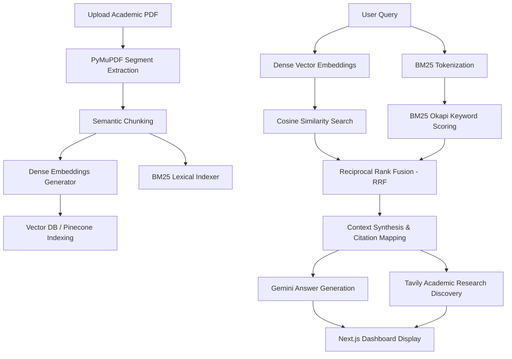

# 🔬 Alethia.ai: AI Academic Explainer & RAG Research Assistant

[](https://nextjs.org/)
[](https://fastapi.tiangolo.com/)
[](https://ai.google.dev/)
[](#-key-features)
[](#-key-features)
[](#-key-features)
[](https://www.pinecone.io/)
[](https://www.typescriptlang.org/)
[](https://tailwindcss.com/)
[](https://opensource.org/licenses/MIT)

**Alethia.ai** (named after the Greek concept *Aletheia* meaning "unconcealment" or "truth") is a state-of-the-art, AI-powered academic literature review and document explanation platform. It leverages retrieval-augmented generation (RAG), hybrid vector + keyword search, automatic language detection, side-by-side paper comparisons, and advanced natural language models to parse complex scientific papers, highlight direct source citations, and discover related literature in real time.

---

## 🚀 Key Features

### 🔍 Hybrid Search (Dense Vectors + BM25 Lexical + RRF)
- **Dense Semantic Understanding**: Embeds document chunks with SentenceTransformers (`all-MiniLM-L6-v2`) to capture high-level conceptual questions, synonyms, and thematic inquiries.
- **Sparse BM25 Keyword Search**: Employs `rank-bm25` (BM25Okapi) to catch exact section numbers (e.g., `Section § 14.2(b)`), technical acronyms (`AdamW`, `ResNet-50`), chemical/mathematical formulas, and statutory references that dense models frequently compress or miss.
- **Reciprocal Rank Fusion (RRF)**: Merges ranked results from both dense vector similarity and sparse BM25 lexical matching using the standard IR formula:
  $$\text{RRF Score}(d) = \frac{1}{60 + \text{rank}_{\text{dense}}(d)} + \frac{\mathbb{I}(\text{bm25\_score}(d) > 0)}{60 + \text{rank}_{\text{bm25}}(d)}$$
  delivering pinpoint precision without requiring arbitrary score normalization.

### ⚖️ Two-Paper Comparative Matrix & Trade-Off Analysis
- **Side-by-Side Comparison**: Select any two uploaded research papers directly from your library to generate an executive comparative synthesis.
- **Structured Markdown Tables**: Automatically creates a side-by-side comparison table analyzing Core Objectives, Architectures/Methodologies, Datasets & Benchmarks, Empirical Results, Computational Complexity, Limitations, and Best Use Cases.
- **Targeted Inquiries**: Provide an optional custom focus area (e.g., *“Compare loss convergence and memory footprint under multi-GPU scaling”*) to tailor the matrix to specific experimental metrics.
- **1-Click Actions**: Easily copy the generated Markdown table to your clipboard or inject the comparison directly into your active dashboard chat feed for deeper follow-up questions.

### 🌐 Multilingual Intelligence (Automatic Detection + Multi-Target Synthesis)
- **Automatic Language Detection**: Uploaded documents are automatically analyzed upon ingestion using `langdetect`. Each paper is tagged in the UI with its detected language code and full name (e.g., English, Spanish, French, German, Hindi, Bengali, Chinese, Japanese, etc.).
- **Dynamic Response Language Selector**: Choose to receive answers and comparative tables in English, Spanish, French, German, Hindi, Bengali, Chinese, Japanese, Arabic, Russian, Portuguese, or leave it on `Auto-Detect` to respond naturally in the language of your query or document.
- **Cross-Lingual RAG**: Ask questions in one language (e.g., Hindi or Spanish) about a paper written in English, and Alethia.ai will accurately extract source evidence and synthesize the explanation in your preferred tongue.

### 📄 Intelligent PDF Processing & RAG
- **Advanced Text Extraction**: Seamlessly parses multi-page PDFs using PyMuPDF.
- **Exact Source Highlighting**: Automatically maps AI claims directly to the exact page and source segment, complete with interactive highlight badges in the PDF viewer.
- **Semantic Vector Storage**: Indexes document chunks into a Pinecone vector database alongside local in-memory caching.

### 🔬 Deep Research Mode
- **Tavily Web Search**: Discovers related research papers, direct links, match percentages, and academic abstracts automatically based on your query context.
- **Context-Aware Memory**: Retains conversation history to allow continuous exploration of complex academic fields.

---

## 🏗️ System Architecture



---

## 🛠️ Technology Stack

| Layer | Component | Technology | Purpose |
| :--- | :--- | :--- | :--- |
| **Frontend** | Next.js 14, TypeScript, React 18 | Web Application UI | Sleek, dark-themed responsive student dashboard |
| **Styling** | Tailwind CSS, Framer Motion | Animations & Style | Premium glassmorphism and typing effects |
| **Markdown & Tables** | `react-markdown` + `remark-gfm` | Markdown Engine | Renders comparative matrix tables, citations, and formulas |
| **Backend** | FastAPI, Python 3.10 | Core API | Text processing, RAG orchestration, and endpoints |
| **Language Detection** | `langdetect` | Linguistic Engine | Detects language code and full name on upload |
| **Keyword Search** | BM25Okapi (`rank-bm25`) | Lexical Retrieval | Exact term matching for legal sections, acronyms, and formulas |
| **Rank Fusion** | Reciprocal Rank Fusion (RRF) | Multi-Strategy Ranker | Merges dense and sparse rankings ($k=60$) |
| **Vector DB** | Pinecone | Database | Sub-millisecond similarity search |
| **Embeddings** | Hugging Face Transformers | Vector Extraction | Light sentence representation model (`all-MiniLM-L6-v2`) |
| **LLM Engine** | Gemini 2.5 via OpenRouter | Intelligence | Model synthesis, explanations, and summarization |
| **Web Research** | Tavily API | Real-time Search | Peer-reviewed academic paper discovery |

---

## ⚙️ Quick Start Setup

### Prerequisites
- Python 3.9+ installed
- Node.js 18+ installed
- A Pinecone account and API key
- An OpenRouter API key (or direct Google Gemini key)
- A Tavily API key

---

### 1. Backend Setup (FastAPI)

1. Navigate to the root directory and create a virtual environment:
   ```bash
   python -m venv venv
   source venv/bin/activate  # On Windows use: venv\Scripts\activate
   ```

2. Install backend dependencies:
   ```bash
   pip install -r requirements.txt
   ```

3. Configure your root `.env` file (copied from `.env.example`):
   ```ini
   OPENROUTER_API_KEY=your_key_here
   PINECONE_API_KEY=your_key_here
   PINECONE_REGION=us-east-1
   TAVILY_API_KEY=your_key_here
   EMBEDDING_MODEL=all-MiniLM-L6-v2
   ```

4. Run the FastAPI development server:
   ```bash
   python server.py
   ```
   The backend will start on `http://127.0.0.1:8000`.

---

### 2. Frontend Setup (Next.js)

1. Navigate to the frontend directory:
   ```bash
   cd frontend
   ```

2. Install node dependencies:
   ```bash
   npm install
   ```

3. Configure your local frontend env file `frontend/.env.local`:
   ```ini
   NEXT_PUBLIC_BACKEND_URL=http://127.0.0.1:8000
   ```

4. Launch the Next.js development server:
   ```bash
   npm run dev
   ```
   Open your browser and navigate to `http://localhost:3000` to launch the platform.

---

## 📡 API Endpoints

| Method | Endpoint | Description | Query / Body Parameters |
| :--- | :--- | :--- | :--- |
| `POST` | `/api/upload` | Upload PDF, detect language, extract/index chunks | `file` (PDF multipart) |
| `GET` | `/api/documents` | List all indexed documents with language badges | None |
| `GET` | `/api/pdf/{doc_id}` | Fetch original PDF file | `doc_id` |
| `DELETE` | `/api/documents/{doc_id}` | Delete document and vector index | `doc_id` |
| `POST` | `/api/search` | **Hybrid / Dense / BM25 search** | `{"query": "...", "doc_id": "...", "top_k": 5, "mode": "hybrid"}` |
| `GET` | `/api/search` | Fast browser hybrid search query | `?query=...&doc_id=...&top_k=5&mode=hybrid` |
| `POST` | `/api/chat` | RAG Chat with exact source highlights & language target | `{"query": "...", "doc_id": "...", "research_mode": false, "target_language": "auto"}` |
| `POST` | `/api/compare` | **Two-Paper Comparative Matrix** | `{"doc_id_1": "...", "doc_id_2": "...", "focus_area": "...", "target_language": "auto"}` |
| `POST` | `/api/research` | Tavily deep academic paper research | `{"query": "..."}` |

---

## 🐳 Docker Deployment

The backend is fully dockerized with a CPU-optimized PyTorch build to keep the memory footprint under 512MB RAM, making it perfect for free tiers like Render, Railway, or Hugging Face.

To build and run the backend container locally:
```bash
docker build -t alethia-backend .
docker run -p 8000:8000 --env-file .env alethia-backend
```

---

## 📄 License
This project is licensed under the MIT License - see the [LICENSE](LICENSE) file for details.

---

<div align="center">
  <p>Made with ❤️ for academic discovery and truth.</p>
</div>